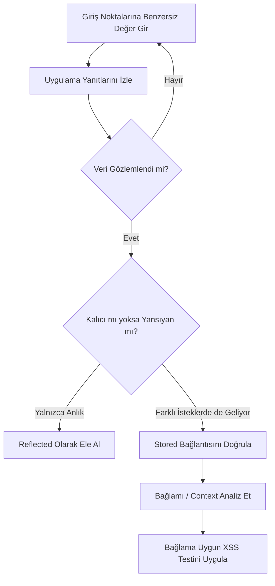
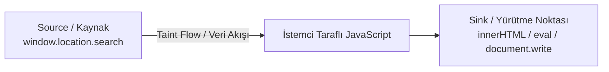

# PortSwigger - Cross-site Scripting (XSS)

Bu doküman, PortSwigger Web Security Academy'nin **Cross-site Scripting (XSS)** modülünden alınan teorik konu anlatımlarını, saldırı türlerini (Reflected, Stored, DOM-based), test metodolojilerini, Mermaid akış şemalarını ve tamamlanan laboratuvar çözümlerini içermektedir.

**Platform:** PortSwigger Web Security Academy  
**Kategori:** Client-Side Vulnerabilities / Cross-Site Scripting (XSS)  
**Resmi Dokümantasyon:** [PortSwigger XSS Guide](https://portswigger.net/web-security/cross-site-scripting)

---

## 1. What is Cross-site Scripting (XSS)?

**Cross-Site Scripting (XSS)**, kötü niyetli bir saldırganın, savunmasız bir web uygulaması üzerinden diğer kullanıcıların tarayıcılarında istemsiz bir şekilde zararlı istemci tarafı (client-side) kod (genellikle JavaScript) çalıştırmasına olanak tanıyan kritik bir web güvenliği zafiyetidir.

XSS, uygulamanın kullanıcı girdilerine aşırı güvenip bu verileri doğrulamadan ve kodlamadan (encoding) tarayıcıya yansıtmasından kaynaklanır.

---

## 2. How does XSS work?

XSS, web uygulamasını manipüle edip kullanıcılara zararlı JavaScript dönmesini sağlayarak çalışır:

* Kurbanın tarayıcısı, gelen yanıtı güvenilir web sunucusundan gelmiş meşru bir sayfa olarak yorumlar.
* İstemci tarafında çalışan zararlı JavaScript kodu sayesinde saldırgan, kurbanın uygulama ile olan oturumunu ve etkileşimini tamamen ele geçirebilir (Session Hijacking).

---

## 3. XSS Proof of Concept (PoC)

Çoğu türdeki XSS zafiyetlerini, kullanıcının tarayıcısında JavaScript kodunun çalıştığını kanıtlayan zararsız bir payload enjekte ederek doğrulayabilirsiniz:

- **`alert()` Fonksiyonu:** Uzun zamandır `alert()` fonksiyonunu PoC amacıyla kullanmak endüstride yaygın olarak kabul edilmiştir. Çünkü bu fonksiyon kısa, zararsız ve başarılı bir şekilde çalıştığında ekranda belirgin bir diyalog kutusu (pop-up) açtığı için fark etmemek imkansızdır.
  ```html
  <script>alert(1)</script>
  ```
- **PortSwigger Laboratuvarları:** PortSwigger lablarının büyük çoğunluğu tarayıcıda `alert()` fonksiyonunu çağırarak çözülebilmektedir.
- **Alternatif (`print()`):** Bazı modern tarayıcılarda `alert()` kısıtlandığında veya WAF filtreleri `alert` kelimesini engellediğinde alternatif olarak `print()` fonksiyonunun kullanılması önerilir:
  ```html
  <script>print()</script>
  ```

---

## 4. XSS Türlerinin Karşılaştırması

| Özellik | Reflected XSS | Stored XSS | DOM-based XSS |
| :--- | :--- | :--- | :--- |
| **Depolama** | Sunucuda saklanmaz, anlık yanıta geri yansıtılır. | Sunucu tarafında (DB, dosya, log) kalıcı saklanır. | Sunucu tarafında saklanmaz; istemci belleğinde ve DOM ağacında işlenir. |
| **İletim Kanalı** | Kurbana özel hazırlanmış bağlantılar (linkler). | Kurbanın yalnızca zafiyetli sayfayı normal ziyareti. | Manipüle edilmiş URL parametreleri veya fragment (`#`). |
| **İşlenme Yeri** | Sunucu yanıtı doğrudan tarayıcıya iletir. | Sunucu yanıtı doğrudan tarayıcıya iletir. | İstemci tarafındaki yerel JavaScript motoru. |
| **Hedef Kapsamı** | Yalnızca linke tıklayan kullanıcı. | İlgili sayfayı/veriyi görüntüleyen tüm kullanıcılar. | Tarayıcı tarafında ilgili betiği tetikleyen kullanıcı. |

---

## 5. Reflected Cross-site Scripting

En yaygın ve temel XSS türüdür. Uygulamanın bir HTTP isteğindeki kullanıcı girdisini alıp, cevabın (response) içerisine gelen veriyi güvensiz/filtrelenmemiş bir şekilde yerleştirmesiyle oluşur.

### Örnek Senaryo:
Kullanıcı şu URL'i ziyaret ettiğinde:
```text
https://insecure-website.com/status?message=All+is+well
```

Sunucunun döndürdüğü HTML çıktısı:
```html
<p>Status: All is well.</p>
```

Eğer uygulama `message` parametresini filtrelemezse, saldırgan kurbana şu zararlı bağlantıyı iletebilir:
```text
https://insecure-website.com/status?message=<script>alert(document.cookie)</script>
```

Sunucu bu isteği aldığında doğrudan şu HTML yanıtını oluşturur ve kurbanın tarayıcısı bu scripti çalıştırır:
```html
<p>Status: <script>alert(document.cookie)</script></p>
```

---

## 6. Stored Cross-site Scripting (Persistent / Second-Order XSS)

### 6.1 Tanım ve Çalışma Mantığı
Stored XSS, uygulamanın güvenilmeyen bir kaynaktan (kullanıcı girdisi, harici API, veritabanı vb.) veri alıp bu veriyi daha sonraki HTTP yanıtlarına **güvensiz bir şekilde (filtresiz veya kodlanmamış)** dahil etmesiyle meydana gelir.

* **Depolanma Alanları:** Yorum satırları, kullanıcı profili ayarları (ad, biyografi), mesajlaşma sistemleri, sipariş geçmişi veya yönetici paneli logları.
* **Etki Seviyesi:** Zararlı kod doğrudan sunucu tarafında depolandığı ve sayfayı ziyaret eden tüm kullanıcılara veya hedeflenen yöneticilere kontrolsüz şekilde servis edildiği için en yüksek etkiye sahip XSS türlerindendir.

### 6.2 Adım Adım İstismar Akışı (Örnek Senaryo)

1. **Kullanıcı Yorum İsteği:**
   ```http
   POST /post/comment HTTP/1.1
   Host: vulnerable-website.com
   Content-Type: application/x-www-form-urlencoded
   Content-Length: 108

   postId=3&comment=%3Cscript%3E%2F*%2BBad%2Bstuff%2Bhere...%2B*%2F%3C%2Fscript%3E&name=Carlos+Montoya&email=carlos%40normal-user.net
   ```

2. **Sunucunun Güvensiz Kaydı:** Sunucu girdiyi doğrulamadan veya HTML entity dönüşümü yapmadan veritabanına kaydeder.
3. **Kurbanın Sayfayı Ziyareti:** Herhangi bir kullanıcı ilgili blog gönderisini açtığında, sunucu yanıtında şu HTML bloğu yer alır:
   ```html
   <p><script>/* Bad stuff here... */</script></p>
   ```
4. **Betiğin Kurban Tarayıcısında Çalıştırılması:** Kurbanın tarayıcısı gelen HTML yanıtını ayrıştırırken `<script>` etiketini doğrudan çalıştırılabilir JavaScript kodu olarak algılar ve kurbanın oturum bağlamında (`document.cookie`) anında tetikler.

### 6.3 Stored XSS Test Metodolojisi

Stored XSS zafiyetlerini manuel olarak tespit etmek, verinin girdiği yer ile ekrana basıldığı yerin farklı zaman ve sayfalarda gerçekleşebilmesi nedeniyle Reflected XSS'e göre daha karmaşıktır. Temel yaklaşım **Giriş (Entry) Noktaları** ile **Çıkış (Exit) Noktaları** arasındaki bağı haritalandırmaktır.

* **Giriş Noktaları (Entry Points):** İstek parametreleri (URL query, POST gövdesi), dosya yolları, HTTP başlıkları (`User-Agent`, `Referer`), bant dışı (Out-of-band) kaynaklar (e-posta içerikleri, API akışları).
* **Çıkış Noktaları (Exit Points):** Depolanan verinin herhangi bir kullanıcıya döndüğü tüm olası HTTP yanıtları (profiller, yönetim panelleri, denetim logları).



---

## 7. DOM-based Cross-site Scripting (DOM XSS)

### 7.1 Tanım ve Temel Mantık
**DOM-based XSS**, istemci tarafında (tarayıcıda) çalışan bir JavaScript betiğinin, saldırgan tarafından kontrol edilebilen bir kaynaktan (**Source**) veri alıp bu veriyi dinamik kod çalıştırmayı veya HTML işlemeyi destekleyen güvensiz bir yürütme noktasına (**Sink**) aktarmasıyla ortaya çıkar.

* **Farkı:** Reflected ve Stored XSS'te zararlı kod sunucu yanıtının (`HTTP Response`) ham HTML'i içinde dönerken, DOM XSS'te sunucudan gelen yanıt tamamen zararsız veya statik olabilir. Güvenlik açığı, **sayfa yüklendikten sonra tarayıcının kendi JavaScript kodlarının DOM nesnelerini güvensizce manipüle etmesinden** kaynaklanır.

### 7.2 Temel Kavramlar: Source, Sink ve Taint Flow



* **Source (Kaynak):** Kullanıcı veya saldırgan tarafından manipüle edilebilen JavaScript nesneleri ve özellikleri (`window.location`, `location.search`, `location.hash`, `location.pathname`, `document.referrer`).
* **Sink (Alıcı / Yürütme Noktası):** Kendisine iletilen girdiyi doğrudan çalıştırabilen veya DOM üzerinde güvensizce yorumlayan tehlikeli JavaScript fonksiyonları ve DOM öznitelikleri.
  * *HTML Sinks:* `innerHTML`, `outerHTML`, `document.write()`, vb.
  * *JavaScript Execution Sinks:* `eval()`, `setTimeout()`, `setInterval()`, `Function()`, vb.
* **Taint Flow:** Güvenilmeyen bir kaynağın (source), aradaki güvenlik kontrollerinden veya filtrelerden geçmeden doğrudan bir yürütme noktasına (sink) akma sürecidir.

### 7.3 DOM XSS Manuel Test Metodolojisi

DOM XSS testlerinde tarayıcının "Sayfa Kaynağını Görüntüle" (*View Source*) seçeneği işe yaramaz; çünkü bu ekran yalnızca sunucudan dönen ham HTML'i gösterir, JavaScript'in DOM üzerinde dinamik olarak yaptığı değişiklikleri göstermez. Testler **Geliştirici Araçları (DevTools - Elements/Console/Sources)** üzerinden yürütülür:

1. **HTML Sink'lerini Test Etme:**
   * Kaynağa benzersiz bir canary dizesi verilir (ör. `?search=alphatest123`).
   * DevTools `Elements` sekmesinde `Ctrl + F` ile aranarak DOM'da nereye düştüğü bulunur.
   * Çift tırnak (`"`), tek tırnak (`'`) veya etiket (`>`) ile öznitelikten çıkış (breakout) denenir.
2. **JavaScript Execution Sink'lerini Test Etme (`eval`, `setTimeout`):**
   * DevTools `Sources` sekmesinde `Ctrl + Shift + F` ile JavaScript dosyalarında `location` referansları aranır.
   * Breakpoint konularak değişkenlerin sink'e aktığı yol debugger ile izlenir (`taint flow`).
3. **Burp Suite DOM Invader:**
   * Burp Suite dahili Chromium tarayıcısında bulunan DOM Invader eklentisi, sayfadaki source ve sink ilişkilerini otomatik olarak takip ederek DOM XSS zafiyetlerini tespit eder.

---

## 8. What can XSS be used for? (Saldırgan Neler Yapabilir?)

Başarılı bir XSS saldırısı elde eden bir saldırgan:
- **Kurban kullanıcıyı taklit edebilir:** Kurbanın tarayıcısında çalışan kod, kurbanın yetkileriyle hareket eder.
- **Kullanıcının yapabildiği herhangi bir işlemi yapabilir:** Parola değiştirme, e-posta güncelleme, para transferi veya veri silme gibi eylemleri tetikleyebilir (CSRF benzeri etki).
- **Kullanıcının erişebildiği hassas verileri okuyabilir:** Kurbanın özel mesajları, hesap bilgileri ve dokümanları çalınabilir.
- **Kullanıcının oturum/giriş bilgilerini ele geçirebilir:** `document.cookie` üzerinden oturum belirteçleri (session tokens / cookies) sızdırılabilir veya sahte giriş kutucukları gösterilerek kimlik bilgileri toplanabilir.
- **Web sitesini tahrif edebilir (Virtual Defacement):** Sayfa görünümünü değiştirip sahte içerikler basabilir.
- **Zararlı yazılım ve trojan işlevleri ekleyebilir:** Tarayıcı istismarı araçları (ör. BeEF) ile istemciyi zombiye dönüştürebilir.

---

## 9. Diğer Önemli Kavramlar

### Content Security Policy (CSP)
**CSP**, modern tarayıcılarda XSS, veri sızdırma ve clickjacking gibi saldırıların etkisini hafifletmek (mitigation) amacıyla geliştirilmiş bir HTTP güvenlik başlığıdır (`Content-Security-Policy`).
* Hangi alan adlarından script, stil, resim ve iframe yüklenebileceğini belirler.
* Satır içi (inline) JavaScript çalıştırmayı varsayılan olarak engelleyebilir veya `nonce` / `hash` mekanizmaları ile yalnızca izin verilen scriptlerin çalışmasını sağlar.

### Dangling Markup Injection
Tam kapsamlı (Full) bir XSS istismarının (örneğin CSP kuralları veya script filtreleri nedeniyle JavaScript çalıştırılamadığı durumlar) mümkün olmadığı senaryolarda kullanılır.
* Kapatılmamış HTML etiketleri (örneğin `` yerine `&gt;`).
3. **Use appropriate response headers (Uygun HTTP Yanıt Başlıkları Kullanın):**
   * `Content-Type: text/html; charset=UTF-8`
   * `X-Content-Type-Options: nosniff`
   * Çerezleri JavaScript erişiminden korumak için `Set-Cookie: ...; HttpOnly; Secure; SameSite=Lax`
4. **Implement Content Security Policy (CSP):** XSS açıklarının istismar edilmesini engellemek için güçlü bir CSP politikası kurgulayın.
5. **Güvenli DOM API'leri Tercih Edin:** `innerHTML` ve `document.write` yerine `textContent` ve `createElement` gibi güvenli metotları kullanın.

---

## 11. Tamamlanan Laboratuvar Çözümleri

- [Lab 01: Reflected XSS into HTML context with nothing encoded](file:///Users/mert/Projects/CyberSecurityPath/portswigger/xss/lab-01-reflected-xss-into-html-context-with-nothing-encoded.md) — Arama fonksiyonundaki Reflected XSS zafiyetinin `alert(1)` ile istismarı.
- [Lab 02: Stored XSS into HTML context with nothing encoded](file:///Users/mert/Projects/CyberSecurityPath/portswigger/xss/lab-02-stored-xss-into-html-context-with-nothing-encoded.md) — Yorum formundaki Stored XSS zafiyetinin `alert(1)` ile istismarı.
- [Lab 03: DOM XSS in document.write sink using source location.search](file:///Users/mert/Projects/CyberSecurityPath/portswigger/xss/lab-03-dom-xss-in-document-write-sink-using-source-location-search.md) — `location.search` kaynağından `document.write` alıcısına akan veride attribute breakout (`onload="alert(1)"`) ile DOM XSS istismarı.
- [Lab 04: DOM XSS in innerHTML sink using source location.search](file:///Users/mert/Projects/CyberSecurityPath/portswigger/xss/lab-04-dom-xss-in-innerhtml-sink-using-source-location-search.md) — `innerHTML` `<script>` bloklarını yürütmediği için inline event handler (``) ile DOM XSS istismarı.
- [Lab 05: DOM XSS in jQuery anchor href attribute sink using location.search source](file:///Users/mert/Projects/CyberSecurityPath/portswigger/xss/lab-05-dom-xss-in-jquery-anchor-href-attribute-sink-using-location-search-source.md) — jQuery `.attr("href", ...)` sink'ine `javascript:` sözde protokolü (`javascript:alert(document.cookie)`) enjeksiyonu ile DOM XSS istismarı.
- [Lab 06: DOM XSS in document.write sink using source location.search inside a select element](file:///Users/mert/Projects/CyberSecurityPath/portswigger/xss/lab-06-dom-xss-in-document-write-sink-using-source-location-search-inside-a-select-element.md) — `<select>` elemanı içinden tag breakout (`</select>`) yöntemi ile DOM XSS istismarı.

---

## Kaynaklar

- [PortSwigger Web Security Academy — Cross-site Scripting](https://portswigger.net/web-security/cross-site-scripting)
- [OWASP Cross Site Scripting (XSS) Prevention Cheat Sheet](https://cheatsheetseries.owasp.org/cheatsheets/Cross_Site_Scripting_Prevention_Cheat_Sheet.html)
